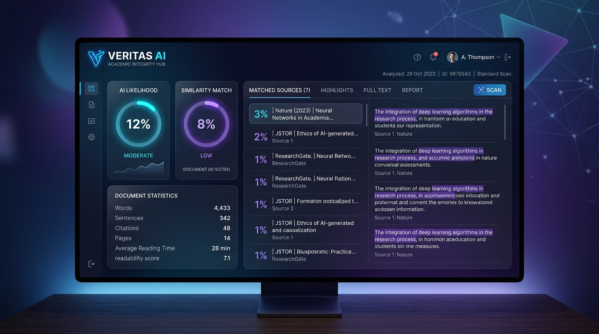

# Veritas AI 🛡️

> The next-generation, privacy-first academic integrity and writing analysis platform.

Veritas AI is a high-performance, fully offline desktop application designed to analyze document originalities, discover similarities, detect AI-assistance likelihood, and track citation attributions securely.



---

## ✨ Features

- 📁 **Offline Multi-Format Extraction**: Extract raw text from standard academic documents (`.docx`, `.pdf`, `.txt`, `.md`, and `.wps`) completely offline without parsing servers.
- 🧬 **Dual Plagiarism Engine**:
  - **Lexical Check**: Computes similarity using n-gram overlap with Jaccard coefficient indices.
  - **Semantic Check**: Uses cosine similarities over normalized term-frequency vectors to detect paraphrased segments.
- 🤖 **AI Likelihood Analysis**: Splits paragraphs into individual sentences and tracks variance/standard deviation of sentence lengths (burstiness metric) to identify uniform AI-generated content.
- 🎓 **Citation & Bibliography Mappings**: Counts in-text attributions (bracketed and parenthetical) and checks for bibliography/works cited headers.
- 💎 **Modern Dark-Mode Report Card**: Interactive glassmorphic dashboard showcasing Turnitin-style metrics with interactive report tabs.

---

## 🚀 Tech Stack

- **Core**: Next.js (React), TypeScript
- **Desktop Runtime**: Electron
- **Style System**: Vanilla CSS (Premium glassmorphic dashboard themes)
- **Document Extractors**: Mozilla PDF.js (Offline bundled), JSZip (for docx structure parsing)
- **Offline Protocol**: Secure custom protocol (`app://local/`) resolving Next static files

---

## 🛠️ Project Structure

```bash
├── backend/                  # Python calibration & reference engines
│   ├── test_docs/            # Sample evaluation documents (DOCX, PDF, TXT)
│   ├── test_docs_runner.py   # Multi-file analysis calibrator
│   └── services/             # Core Python modules (similarity, extract, ai)
├── electron/                 # Electron bootstrap & main process configs
│   └── main.js               # Protocol routing & asset server
├── public/                   # Static app resources & demo assets
├── src/                      # Next.js Application Source
│   ├── app/                  # Router pages (dashboard, settings, main uploader)
│   └── lib/                  # TypeScript verification algorithms
├── package.json              # App metadata, scripts, and dependencies
└── tsconfig.json             # TypeScript compile options
```

---

## 📦 Installation & Setup

### Prerequisites
- [Node.js](https://nodejs.org/) (v18.x or later recommended)
- [Python 3.10+](https://www.python.org/) (for backend engine calibration)

### 1. Client Installation
Clone the repository and install dependencies:
```bash
git clone https://github.com/Asadobhaya/Veritas-AI.git
cd Veritas-AI
npm install
```

### 2. Configure Environment (Optional)
If running docker/database containers:
```bash
cp .env.example .env
```
*(Note: Core analysis and the desktop application run 100% offline out-of-the-box without requiring database setup.)*

---

## 💻 Development & Execution Scripts

### Option A: Start Web Version in Browser (Quickest)
```bash
npm run dev
```
Open [http://localhost:3000](http://localhost:3000) in your web browser.

### Option B: Launch Desktop Application (Electron)
```bash
npm run electron
```
*(This automatically compiles Next.js static assets and launches the native desktop window.)*

If you have already built the app and want to start Electron instantly:
```bash
npm run electron:dev
```

### Package Portable Installer (.EXE)
To bundle static routes and package the application into a single portable Setup installer for Windows:
```bash
$env:ELECTRON_SKIP_DOWNLOAD = "1"
npm run electron:build
```
The compiled installer will be saved at `dist/Veritas-AI-Setup.exe`.

---

## 🧪 Calibration & Evaluation Suite
To run the python test suite against your evaluation documents directory:
```bash
cd backend
python -m venv venv
venv\Scripts\activate
pip install -r requirements.txt
python test_docs_runner.py
```

---

## 📄 License
This project is licensed under the [MIT License](LICENSE).
